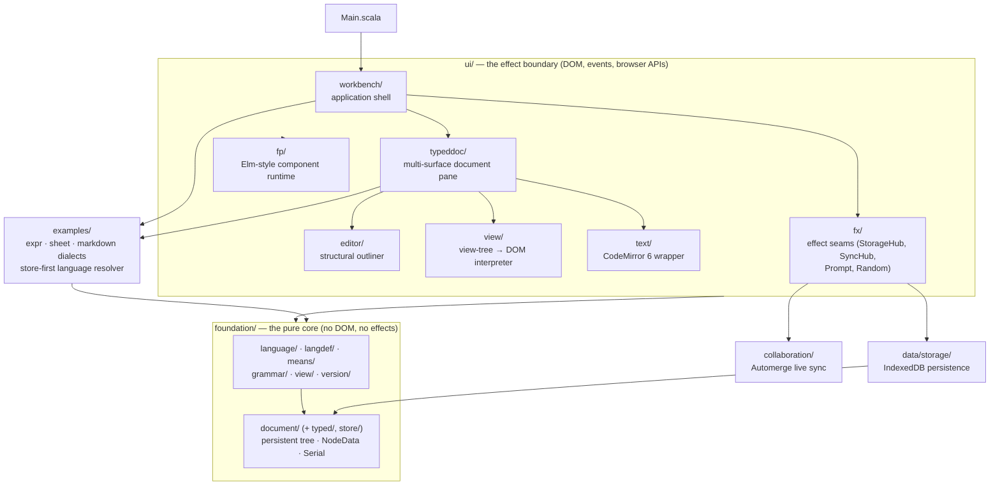
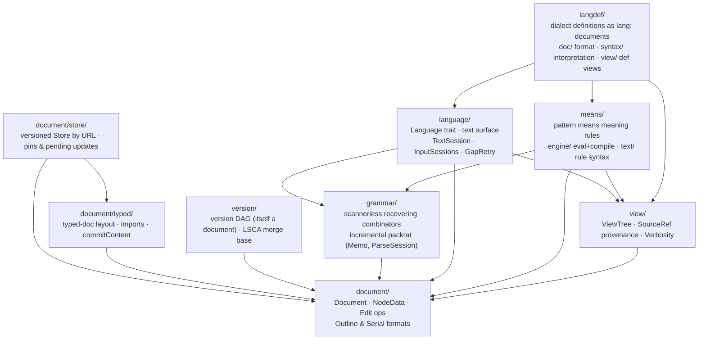
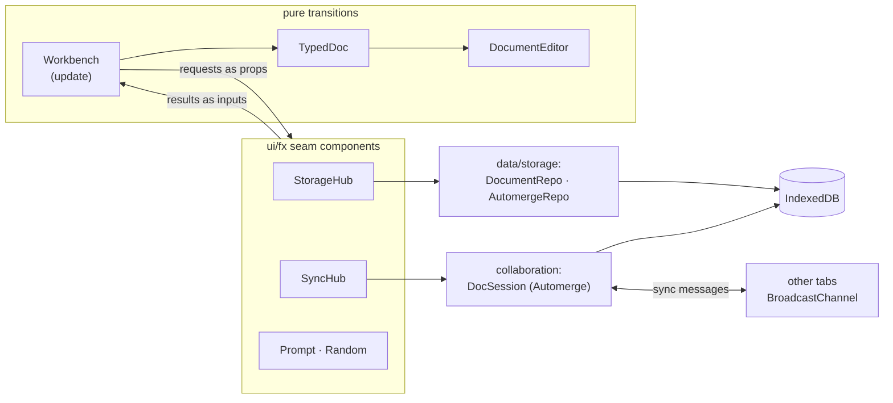
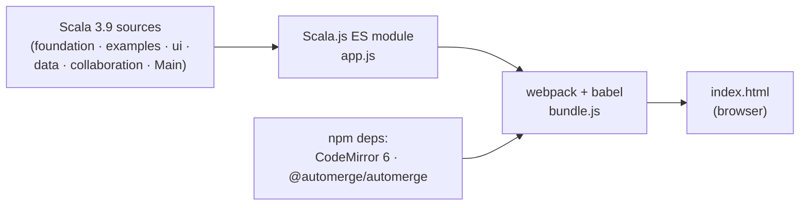

# Opelan — Architecture

Opelan is a browser-based language workbench written in Scala.js: programs,
documents, and tooling are all versioned, structured trees that can be viewed
and edited through multiple surfaces. It runs local-first — no server —
persisting to IndexedDB and syncing between tabs via Automerge.

Two constraints shape everything below:

- **Pure core, thin effects.** `foundation/` (and `examples/`) is immutable
  data and total functions — no DOM. All effects live in `ui/`, declared as
  values and interpreted at the edge (`ui/fx`).
- **One canonical tree, many surfaces.** `Document[NodeData]` is the single
  source of truth. The structural editor, the text surface, and derived views
  are projections over it — never separate models to keep in sync.

Each package's detailed design lives in a `DESIGN.md` beside the code; this
file is the map between them.

## Layered view

Dependency rules visible in the diagram:

- `ui/` depends on `foundation/` and `examples/`; nothing in `foundation/`
  or `examples/` depends on `ui/`.
- `ui/fp` and `ui/text` are leaf libraries — they import nothing from
  `opelan.*` (DOM and CodeMirror only).
- `collaboration/` also imports nothing from `opelan.*` — it syncs `Serial`
  *text*, staying agnostic of the document model. `ui/fx/SyncHub` is the
  bridge that parses synced text back into `Document[NodeData]`.
- `data/storage` knows only `foundation/document`: `DocumentRepo` maps
  `url@version` records to `Serial` text; `AutomergeRepo` stores opaque
  sync bytes.
- Effects reach `data/` and `collaboration/` **only** through `ui/fx`
  seam components, so every decision stays a pure transition in
  `workbench`'s update functions.

## Inside `foundation/`

Reading bottom-up: `document/` is the substrate — a persistent tree of
`NodeData` payloads (strings, numbers, internal refs, `url@version#node`
external refs, `GapData`, `SourceRef`). `typed/` fixes the layout that makes a
tree a *typed document* (type ref + imports + title + content); `store/` makes
documents addressable and versioned. `grammar/` provides the incremental
parser machinery; `means/` compiles readable `pattern means meaning` rules
into those combinators and evaluates against them; `language/` ties it
together into the `Language` interface with incremental sessions; `langdef/`
interprets a stored `lang:` document *as* a `Language` — which is how dialects
become data. `view/` is the vocabulary languages emit for derived views;
`version/` is the branching history DAG (itself a document).

## One document, many surfaces

The polysyntactic core: all editing surfaces read and write the same canonical
tree. `TypedDoc` owns the incremental parse sessions (`TextSession`,
`InputSessions`, `GapRetry`) and composes the surfaces as `fp` children.

```mermaid
flowchart TB
    subgraph Surfaces["Surfaces (projections, not models)"]
        direction TB
        Ed["Editor surface<br/>ui/editor — structural outliner"]
        Txt["Text surface<br/>ui/text CodeMirror + TextSession<br/>(incremental packrat parse)"]
        Drv["Derived views<br/>print · eval · sheet · formulas · preview<br/>language.render → ViewTree → ViewTreeView"]
    end

    Doc[("Document&#91;NodeData&#93;<br/>the canonical tree")]

    Ed -->|"structural edits (Edit ops)"| Doc
    Txt -->|"keystroke → incremental parse → commitContent"| Doc
    Doc -->|"re-derived docText"| Txt
    Doc -->|"render(view)"| Drv
    Drv -->|"projected input commits<br/>(SourceRef → commitContent)"| Doc
```

`commitContent` (`foundation/document/typed`) reconciles a parse back into
the tree keeping node ids stable, so refs keep resolving and unchanged
subtrees keep identity across every edit path.

## Effects at the edge

The `fp` runtime runs one FIFO input queue; components return outputs and
declare children — they never perform effects. `ui/fx` seam components are the
only places requests become real.

## Persistence and sync

Two layers of history, two formats:

- **Curated layer** — `Store` checkpoints (`url@version`), saved as `Serial`
  text in IndexedDB via `DocumentRepo`. Deliberate, labeled, addressable.
- **Operational layer** — an Automerge `{text}` doc per synced document
  (`DocSession`). Local edits become Automerge changes; sync messages flow
  over `BroadcastTransport` to sibling tabs; the bytes persist so a reload
  resumes. Received text is parsed back into `Document[NodeData]`, and the
  change graph is projected as the shared, author-tagged history DAG
  (`foundation/version`). Per-actor undo (`SessionUndo`) reverts only one's
  own changes.

```mermaid
flowchart LR
    Doc2["Document&#91;NodeData&#93;"] -->|"Serial"| Save["DocumentRepo.save"] --> Docs[("IndexedDB<br/>documents")]
    Doc2 -->|"Serial text"| DS["DocSession"] -->|"change"| AM[("Automerge doc")]
    AM --> AMBytes["AutomergeRepo"] --> AMDocs[("IndexedDB<br/>automerge_docs")]
    DS <-->|"sync msgs"| BC["BroadcastChannel"] <-->|"sync msgs"| PeerDS["peer DocSession"]
    PeerDS -->|"text → parse"| PeerDoc["peer Document&#91;NodeData&#93;"]
```

Syncing serial text is scaffolding: the destination is a tree-native CRDT
replicating document structure directly (see
[`collaboration/DESIGN.md`](collaboration/DESIGN.md)).

## Build pipeline

`build.bat`/`build.sh` run the full pipeline; `test.bat`/`test.sh` run the
munit suite in `test/` against the pure core (Scala.js + Node), with
`TEMP`/`TMPDIR` redirected to `./.tmp` so Node resolves `node_modules`.

## Where things live

| Concern | Package | Design doc |
|---------|---------|------------|
| Persistent tree, `NodeData`, `Outline`/`Serial` | `foundation/document` | [link](foundation/document/DESIGN.md) |
| Typed-doc layout, `commitContent` | `foundation/document/typed` | [link](foundation/document/typed/DESIGN.md) |
| Versioned `Store`, pins, updates | `foundation/document/store` | [link](foundation/document/store/DESIGN.md) |
| Version DAG, merge base | `foundation/version` | [link](foundation/version/DESIGN.md) |
| Incremental parser combinators | `foundation/grammar` | [link](foundation/grammar/DESIGN.md) |
| `Language` trait, text/input sessions | `foundation/language` | [link](foundation/language/DESIGN.md) |
| `lang:` documents → dialects | `foundation/langdef` | [link](foundation/langdef/DESIGN.md) |
| `means` rules, engine, rule text | `foundation/means` | [link](foundation/means/DESIGN.md) |
| View-tree vocabulary | `foundation/view` | [link](foundation/view/DESIGN.md) |
| Demo dialects, resolver | `examples` | [link](examples/DESIGN.md) |
| Component runtime | `ui/fp` | [link](ui/fp/DESIGN.md) |
| Structural editor | `ui/editor` | [link](ui/editor/DESIGN.md) |
| Multi-surface pane | `ui/typeddoc` | [link](ui/typeddoc/DESIGN.md) |
| CodeMirror wrapper | `ui/text` | [link](ui/text/DESIGN.md) |
| View-tree renderer | `ui/view` | [link](ui/view/DESIGN.md) |
| Effect seams | `ui/fx` | [link](ui/fx/DESIGN.md) |
| Application shell | `ui/workbench` | [link](ui/workbench/DESIGN.md) |
| IndexedDB persistence | `data/storage` | [link](data/storage/DESIGN.md) |
| Automerge sync, undo, transports | `collaboration` | [link](collaboration/DESIGN.md) |
| Test suite (munit over the pure core) | `test` | — |
